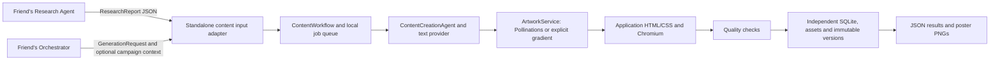

> Approved by the user for execution on 2026-11-08. This is the preserved review-stage plan; see VERIFICATION.md for completed results.

# Content Creation Agent extraction plan

Prepared 2026-11-08. Status: inspected; awaiting authorization to copy.

Source: `D:\Projects\AI_Social_Media` (read-only throughout).
Proposed destination: `C:\Users\HP\OneDrive\Desktop\Content Agent`.
The Windows Desktop resolves to this OneDrive directory. The destination did not exist when inspected.

## Authorization boundary

This document proposes the extraction; no application files have been copied and no destination directory has been created. Only this plan and a tracked-file baseline were written outside the original repository. No source application imports, tests, dependency installs, migrations, API requests, or workers were executed. No original secrets were read or displayed.

Authorize this plan before copying. That authorization covers creating the destination, copying the allowlisted files, making the destination-only integration adaptations described below, and testing only the independent copy. Any required filesystem escalation will use the platform approval mechanism. It does not authorize changes to the original, live generation calls, paid calls, publishing, UI redesign, or Git changes.

## What the implementation actually contains

`backend/app/agents/content.py:ContentCreationAgent.generate` builds the content prompt inline, calls an injected text service, validates structured output and performs a bounded correction attempt. There is no separate prompt directory or HTML template file to extract.

`backend/app/workflow.py:ContentWorkflow` implements the six stages: validation, text generation, artwork, poster rendering, quality checks, persistence. It also handles concept checkpoints, shared/distinct platform creatives, partial failures, deferred provider retries, immutable version creation, and optional text revisions. `JobRunner` handles the persistent queue and interrupted jobs. This is the content workflow, distinct from `coordinator_workflow.py`.

`services/renderer.py` owns the HTML string, escapes supplied text, combines allowlisted CSS with theme/platform CSS, embeds local assets, and renders PNGs with Playwright Chromium. It currently loads Inter from frontend dependencies. There is no need to extract React to render posters.

## Dependency map and copy manifest

Paths below are relative to the source root. Preserve the `backend/app` package layout to minimize import changes.

| Group | Source files | Destination treatment |
|---|---|---|
| Core content | `backend/app/agents/content.py`, `backend/app/agents/revision.py`, `backend/app/workflow.py` | Copy unchanged; preserve prompts and generation logic. Revision support is included because the workflow imports it. |
| LLM and prompt helpers | `backend/app/services/providers.py`, `text_budget.py`, `visual_direction.py` | Copy unchanged. Providers is shared source code; retain existing content adapters without importing the Research Agent. |
| Artwork and storage | `backend/app/services/artwork.py`, `background_check.py`, `assets.py` | Copy unchanged; retain OCR gating, bounded retries, configurable exclusions and explicit gradient mode. |
| Rendering and quality | `backend/app/services/renderer.py`, `quality.py` | Copy; change only renderer font lookup/error text to the standalone bundled font. Preserve HTML, escaping, fit checks and quality logic. |
| Application templates | `backend/app/templates/__init__.py`, `themes.py`, `platforms.py`, `editorial-v1.css`, `spotlight-v1.css`, `bulletin-v1.css` | Copy unchanged. |
| Package markers | `backend/__init__.py`, `backend/app/__init__.py`, `backend/app/agents/__init__.py`, `backend/app/services/__init__.py` | Copy after confirming they contain no startup side effects. |
| Shared contracts | `backend/app/contracts.py` | Copy required content/report/job/version contracts and their validators unchanged; omit unrelated dashboard and agent-settings contracts. Retain campaign input shape only as optional caller-supplied context. |
| Shared ORM | `backend/app/models.py` | Copy `now_iso`, `Base`, `Campaign`, `ResearchRun`, `GenerationJob`, `Asset`, `ContentItem`, `ContentVersion` definitions unchanged into destination-only models. Campaign and report tables satisfy workflow foreign keys; neither implies an agent implementation. |
| Settings and database | `backend/app/config.py`, `database.py` | Copy and narrow settings to content/storage/artwork; preserve engine pragmas. Root resolves inside the copy. Add a guard rejecting storage paths in the source tree or reached through links. |
| Local protection | `backend/app/services/data_lock.py`, `local_security.py` | Copy unchanged for the standalone host. |
| Required font | `frontend/node_modules/@fontsource/inter/files/inter-latin-600-normal.woff2`, `frontend/node_modules/@fontsource/inter/LICENSE` | Copy only this font and license to `assets/fonts/`; do not copy frontend dependencies. Both were confirmed present. |
| Migrations | `backend/alembic.ini`, `backend/migrations/env.py`, content schema in migrations `0001`, `0002`, `0003`, `0005`, `0006` | Create a destination-only initial Alembic migration matching the selected current tables, nullable trash/deletion fields, uniqueness constraints and immutable-version triggers. Original chain includes unrelated research/publishing migrations and cannot be used wholesale. No original database is copied. |
| Test fixtures | five JSON files in `demo_reports/` and their README | Copy to an explicitly labeled test-fixture location; never seed normal runtime storage. |
| Relevant tests | See test adaptation list below | Copy selected tests/helpers; adapt only their standalone setup/imports and excluded-app assertions. Document each adaptation. |

Additional source files must be reviewed and added to the manifest before copying; never use a recursive repository copy. Record hashes for unchanged copies and destination diffs for adapted files.



## Exclusions and exact boundary adaptations

- Exclude Research Agent, search/retrieval services, research API/workflow/jobs; Coordinator Agent/API/workflow; Publishing Agent, approval execution, scheduling, Facebook, Instagram, LinkedIn/manual workflows, Meta authentication, Cloudinary, delivery/recovery services and their credentials/tables.
- Do not copy `backend/app/main.py`: it imports and initializes all agents, publishing services and workers. Write a minimal destination-only FastAPI host for content, local protections, migrations and the content worker.
- Do not copy `content_api.py` wholesale. Reuse its content-only route bodies for submit/status/retry/cancel/history, library/version retrieval, validated manual edits, natural revisions, preview and asset retrieval. Its `version_view` lazily imports approval review; restoration calls approval checks; deletion calls a cross-application deletion service. Remove those couplings only in the destination. Return explicit `unapproved`/`not_published` metadata; provide no approval or publishing execution routes. Keep version restoration's content integrity/asset checks locally. Exclude trash/permanent-deletion UI and endpoints from this starting-point extraction; retain nullable ORM fields because the unchanged workflow checks them.
- Provide a small report-import boundary: validate `ResearchReport`, persist its immutable source snapshot, reject conflicting reuse of a report ID. No live research or automatic demo import. Preserve report references across versions and restarts.
- Preserve optional campaign context through the existing `Campaign` snapshot shape and default/approved-fact merging. Allow callers to supply it without copying campaign orchestration or its UI. Omitted campaign means no campaign row is needed.
- Keep provider source code intact, including its reusable research branch, rather than editing generation logic. The standalone host exposes only content configuration and does not create Research jobs.
- Create `.env.example` from required names, not by copying `.env`. Copy no production data, outputs, logs, caches, virtual environments, `.git`, OAuth tokens, social connections or runtime settings.
- No React frontend in this extraction. Usage is a documented Python interface and local content API/OpenAPI. Another developer can add their own UI.

## Input and output integration contract

1. Caller supplies a `ResearchReport` with schema version, UUID, topic, summary, sources, claims, evidence references and preparation timestamps. Live reports require `researched_at`; evidence must reference existing source IDs and verification status must agree with evidence relations. Treat all supplied content as untrusted data. A report labeled live is the caller's assertion, not verification performed by this agent.
2. Caller supplies `GenerationRequest` with matching report ID, topic, audience/tone, platforms, concept/slide counts, style/template/brand options, caption length, hashtags and artwork choice. Keep all existing validation and defaults. Supported generated output: 1–3 concepts, each 1 poster or 2–5 carousel slides.
3. Standalone adapter checks request/report ID consistency and creates the existing job snapshot: request, report, content provider/model, seed ID, prompt version, optional campaign snapshot. Caller provides an idempotency key; the existing queue cap and collision safeguards are preserved.
4. Persist and expose job ID, generation status, stage events, partial failures and result item/version IDs. Results include captions/hashtags, claim references, slides, background asset IDs, platform exports, rendered asset IDs, quality warnings and immutable version metadata/digests. Preserve source snapshots for later retrieval.
5. Every slide within each creative carousel references the exact same background asset ID. Shared mode reuses the background across platform exports; distinct-platform mode intentionally uses a different background per platform creative, reusing that background within its carousel.
6. Quality is separate from generation. Quality warnings are not approval. All outputs remain unapproved and unpublished; the friend's application must implement explicit human approval for an exact version/payload before publishing.

## Independent project structure

```text
Content Agent/
  backend/app/                 # original package paths, content only
    agents/  services/  templates/
    main.py  config.py  database.py  models.py  contracts.py
  backend/migrations/         # isolated initial content schema
  backend/alembic.ini
  assets/fonts/               # Inter WOFF2 and license
  tests/fixtures/reports/      # explicitly labeled demo fixtures
  tests/                      # adapted relevant tests, isolation tests
  examples/                   # validated research/request examples
  requirements.txt
  requirements-dev.txt
  .env.example
  .gitignore
  README.md
  EXTRACTION_MANIFEST.json
  VERIFICATION.md
  data/                       # created only inside this copy at runtime
```

Use Python 3.12; source environment metadata identifies 3.12.5. Create a fresh destination `.venv`. Derive pins from the source requirements and verify only the needed dependency closure: FastAPI/Uvicorn, Pydantic/settings, SQLAlchemy/Alembic, httpx, LangGraph/LangSmith, Pillow, Playwright, RapidOCR/ONNX and their actual transitive dependencies. Pytest belongs in development requirements. Do not carry over publishing-only cryptography or research-only BeautifulSoup solely because the main application uses them. Do not upgrade the original environment.

Required configuration names: `CONTENT_PROVIDER`, `CONTENT_MODEL`, `CONTENT_API_KEY`, `POLLINATIONS_API_KEY`, `POLLINATIONS_MODEL`, `POLLINATIONS_NEGATIVE_PROMPT`, `ARTWORK_MAX_ATTEMPTS`, `APP_DATA_DIR`, and local API origins if exposed. Supply no credential values. Defaults and template settings come from source code; unsupported provider choices remain unsupported.

The inspected Pollinations adapter uses authenticated GET `https://gen.pollinations.ai/image/{encoded_prompt}`, square background dimensions, and exclusions appended to the prompt rather than a dedicated negative-prompt parameter. These are code findings, not a fresh assertion of service availability/free allowance. Before any future live use, check official current endpoint/model/account eligibility without making a generation request. No live verification is part of the authorized offline test plan, and no paid fallback is permitted.

## Verification gates after authorization

1. Before copying, recheck destination nonexistence and path resolution; refuse symlink/junction redirection or overwriting existing work. Extend the external baseline to relevant untracked/ignored original configuration and runtime file hashes without exporting their contents. Record source Git HEAD/status and tracked hashes. Do not open the original SQLite through an application or database client.
2. Copy only allowlisted reviewed source/assets, scan the extracted files for secrets and original absolute paths, and record provenance/destination-only adaptations. Stop if an actual secret is found; do not display it.
3. Install dependencies only into the new `.venv`; keep browser/OCR/test caches and artifacts in destination or approved temporary locations. Install Chromium there if needed. No imports or pytest collection from the original package. Disable optional tracing and fail tests on unmocked external HTTP.
4. Adapt tests from `test_content.py`, `test_artwork.py`, `test_templates.py`, `test_platform_exports.py`, `test_distinct_creatives.py`, `test_natural_revision.py`, `test_provider_failures.py`, `test_text_reliability.py`, `test_visual_direction.py`, `test_poster_output_audit.py`, and `test_hashtags.py`. Review helper dependencies recursively. Replace the full-app `backend/tests/app_fixture.py` bootstrap with the standalone host; do not copy publishing simulator setup. Keep valid content assertions, separately document omitted approval/publishing/deletion assertions.
5. Actually test imports, dependency completeness, initialization, malformed inputs/outputs, source/claim validation, counts, bounded retries, errors without silent fixture fallback, all templates/platform dimensions, escaping/overflow, natural revisions and background reuse. Use fixture LLM responses and mocked Pollinations HTTP. Real Chromium renders and local gradients are distinct from live artwork. Load local OCR without permitting network generation; report any model-download/setup limitation.
6. Test progress persistence, partial-stage retry, immutable versions and retrieval after a fresh process. Test separate configuration/output paths and refusal to point at the original, including path aliases/links. Confirm no research/publishing workers or endpoints start.
7. Recompare original tracked hashes, Git HEAD/status, and the covered ignored/untracked files. File-tree comparisons identify added/deleted paths within the recorded scope. If another running application changes runtime data, report it and do not claim a complete unchanged-original guarantee. Do not stop or alter original processes without authorization.
8. README includes setup/activation, requirements and Chromium install, blank environment configuration, report ingestion, request submission, status/result retrieval, output locations, interfaces, architecture diagram, examples and known limitations. Verification report lists commands actually run, outcomes, excluded components, manual setup, fixture/live distinction and remaining blockers.

## Inspection evidence and limitations

- Initial Git status output was empty. Subsequent status remained empty; both staged and unstaged `git diff --exit-code` checks returned 0.
- `source-baseline.json` beside this document records SHA-256 hashes for tracked files and current HEAD/status. It covers tracked file bytes, not ignored runtime data or installed packages. It was captured during inspection, not before the first read.
- Source runtime behavior and existing test-suite success were not reverified. No tests were executed in the original project.
- Extraction is feasible without changing original files. A literal unmodified file copy alone would not be standalone because startup, shared persistence/API boundaries and the frontend font path are coupled. The destination-only adaptations above are necessary packaging work; generation logic stays unchanged.
- Copying and standalone acceptance remain pending. This plan is not a claim that an extracted agent exists or works.
