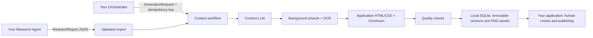

# Standalone Content Creation Agent

This independent Python component turns a caller-supplied, source-backed research report into social captions, hashtags and poster/carousel PNGs. It preserves the original content prompts, generation workflow, provider adapters, artwork/OCR checks, HTML/CSS layout and quality checks. It includes text revisions, retries, immutable versions and local persistence. It has no Research Agent, Coordinator Agent, publishing integrations, approval execution, login or React UI.

## Architecture



The six separate stages are validation, text generation, artwork generation, poster rendering, quality checks and persistence. The queue saves checkpoints and keeps successful outputs after partial failure. Tracing is disabled around generation. Nothing is automatically approved or published.

## Files

- `backend/app/agents/`: original content generation and constrained text revisions. Prompts are inline in these Python files.
- `backend/app/workflow.py`: content-only workflow and worker; this is not the main Coordinator Agent.
- `backend/app/services/`: replaceable text, artwork, storage and rendering services, local safeguards and quality checks.
- `backend/app/templates/`: three allowlisted CSS layouts plus platform/theme styles. Renderer HTML is application-owned Python code.
- `backend/migrations/`: frozen, isolated Alembic initial schema for content tables only.
- `assets/fonts/`: original Inter font and its redistribution license; no Node/frontend installation is required.
- `backend/tests/` and `tests/fixtures/reports/`: offline acceptance tests and five labeled historical demo reports. Normal runtime never seeds them.
- `examples/`: input JSON schemas and request example.
- `data/app.sqlite3` and `data/assets/`: your own runtime state and outputs, created on startup/use. Test data stays in `.cache/pytest-tmp` and labeled test renders in `data/verification`.
- `EXTRACTION_MANIFEST.json`, `verification/`, `VERIFICATION.md`: provenance, source comparisons and actual test results. Extraction scripts are audit records and need not be run by a recipient.

## Requirements and setup

Python 3.12 (extraction used 3.12.5), Windows and Chromium are required. No original project or original environment is needed. Transfer the folder excluding `.venv`, `.cache`, test-generated `data/`, and any future `.env`; recreate the environment on your friend's computer. Source code and assets alone do not contain your API keys or runtime database.

Run PowerShell from this folder:

```powershell
New-Item -ItemType Directory -Force .cache/tmp | Out-Null
$env:TEMP = Join-Path $PWD '.cache/tmp'
$env:TMP = $env:TEMP
$env:PIP_CACHE_DIR = Join-Path $PWD '.cache/pip'
python -m venv .venv
$env:PLAYWRIGHT_BROWSERS_PATH = Join-Path $PWD '.cache/ms-playwright'
.\.venv\Scripts\python.exe -m pip install -r requirements.txt
.\.venv\Scripts\python.exe -m playwright install chromium
if (-not (Test-Path .env)) { Copy-Item .env.example .env }
```

Edit the new `.env` with your own settings. Never copy the original application's `.env` or reuse its database. `APP_DATA_DIR` defaults to this folder's `data`; it must resolve to a subdirectory of this independent project. Resolved paths outside the project, including junction escapes, are rejected. Do not rename the source package layout inside this copy without updating its root discovery.

The installed virtual environment and Chromium in this extraction are local conveniences, not portable binaries. All direct and resolved runtime dependencies are pinned in `requirements.txt`; test dependencies are separately pinned in `requirements-dev.txt`. `requirements-verified.txt` records the complete environment used for acceptance.

## Configuration

| Name | Meaning |
|---|---|
| `CONTENT_PROVIDER` | `groq`, `gemini`, or `openrouter`. OpenAI is accepted by the shared settings type but has no enabled adapter and will fail explicitly. |
| `CONTENT_MODEL` | Explicit compatible model; source default is `openai/gpt-oss-120b` on Groq. Eligibility and quotas depend on your own account. |
| `CONTENT_API_KEY` | Your own backend-only LLM credential. Required for real text generation. |
| `POLLINATIONS_API_KEY`, `POLLINATIONS_MODEL` | Your own optional background-artwork credential/model. Required for Pollinations mode. |
| `POLLINATIONS_NEGATIVE_PROMPT` | Optional exclusions override; existing defaults are preserved. Exclusions are appended to the image prompt, not sent as an assumed dedicated parameter. |
| `ARTWORK_MAX_ATTEMPTS` | Existing bounded OCR/artwork attempt count, 1–3; default 2. |
| `APP_DATA_DIR` | Independent database/assets directory inside this project. |
| `APP_ALLOWED_ORIGINS` | Optional JSON list of allowed local browser origins; defaults match port 8001. |

Keep tracing disabled. There is no paid provider fallback. OpenRouter accepts only explicit `:free` models or `openrouter/free`; other accounts/providers still require you to verify your free allowance. No live generation or provider-capability probe was performed during extraction. Before future Pollinations use, check current official model/endpoint/account eligibility. The preserved adapter calls authenticated `https://gen.pollinations.ai/image/{prompt}`. Do not assume a model is available or free merely because the adapter exists.

## Start

```powershell
.\tools\run.ps1
```

This starts a single content worker on `http://127.0.0.1:8001`, leaving the original application's port independent. Open `/docs` for the API description or `/openapi.json` for machine-readable contracts. Keep the process running while jobs execute. Stop with Ctrl+C. Do not run multiple workers against one database. If script execution is restricted, use a process-scoped policy of your choice or run the Uvicorn command in `tools/run.ps1` after setting its folder-local environment variables; no machine-wide policy change is required.

Startup has an empty report store. It does not call external services. Real generation starts only after you submit a request and configure credentials. Missing live credentials fail visibly; runtime does not substitute a test response. `application_gradient` is an explicit, labeled artwork choice, not Pollinations artwork; it does not replace the need for a real text provider in normal runtime.

## Connect your Research Agent

Your Research Agent must produce a `ResearchReport`; see `examples/research.schema.json` and the live OpenAPI contract. Required input includes:

- UUID `id`, `schema_version: "1"`, `origin: "live"`, topic and summary.
- `prepared_at` and `researched_at` with time zones.
- Sources with stable local IDs, URLs, title, publisher and retrieval timestamp; optional publication date.
- Claims with stable local IDs, text, verification status/method, limitations, and supporting or contradicting evidence referencing existing source IDs.

Importing a report validates its structure and evidence references. It does not perform research or independently verify claims. The caller is responsible for truthful provenance. Demo-origin input is rejected by normal runtime. User-provided promotional facts belong in `approved_user_facts`; they must not be represented as independently researched claims.

```powershell
$api = 'http://127.0.0.1:8001/api/v1'
# research.json comes from your own Research Agent.
$reportJson = Get-Content -LiteralPath .\research.json -Raw
$report = Invoke-RestMethod -Uri "$api/research-reports" -Method Post -ContentType 'application/json' -Body $reportJson
```

Reimporting identical content under the same report ID is idempotent. Different content under that ID returns 409; assign a new UUID. The stored report remains available through `GET /research-reports/{id}` and historical content retains its source snapshot.

## Submit a content request

```powershell
$request = @{
    topic = $report.topic
    report_id = $report.id
    concept_count = 1
    slide_count = 2
    platforms = @('instagram', 'facebook', 'linkedin')
    export_mode = 'per_platform'
    creative_mode = 'shared'
    caption_length = 'balanced'
    hashtag_count = 3
    template_id = 'editorial-v1'
    artwork_mode = 'application_gradient'
} | ConvertTo-Json -Depth 10
$job = Invoke-RestMethod -Uri "$api/generation-jobs" -Method Post -ContentType 'application/json' -Headers @{'Idempotency-Key'=[guid]::NewGuid().ToString()} -Body $request
Invoke-RestMethod -Uri "$api/generation-jobs/$($job.id)"
```

The example explicitly chooses a local gradient. Select `pollinations` only after checking your account and configuring artwork credentials. Generation makes 1–3 concepts, each a poster (`slide_count=1`) or a 2–5-slide carousel. Templates are `editorial-v1`, `spotlight-v1`, `bulletin-v1`. Themes are `light`, `dark`, `colorful`; caption lengths are `concise`, `balanced`, `detailed`.

With `creative_mode=shared`, each concept uses one background across its slides/platform crops. With `distinct_platforms`, each platform receives separate copy and background; every slide within that platform's carousel uses the exact same background asset ID. Distinct mode requires `export_mode=per_platform`. Export dimensions are Instagram 1080×1350, Facebook 1080×1080 and LinkedIn 1200×900; `shared_square` preserves the legacy 1080×1080 format.

Job states include queued, running, succeeded, partial, failed, interrupted and cancelled. Provider throttling can leave a queued job waiting for its saved retry time. Poll until a terminal state or handle the saved waiting state; do not resubmit automatically under new idempotency keys. Reusing a key with different input returns 409. Queue admission is capped at ten queued/running jobs.

## Outputs, retries and versions

`GET /generation-jobs/{job_id}` returns stage events, error/status and result item/version IDs. `GET /content/{item_id}` returns the current immutable version projection: structured concept, captions/hashtags, slides and claim IDs, request/source/provider metadata, background IDs, rendered IDs, platform exports, quality status/warnings/failures, and explicit unapproved/not-published states. `GET /content/{item_id}/versions` returns history; `GET /content` lists/searches saved content.

Fetch PNG bytes through `GET /assets/{asset_id}?download=true`; files are registered under `data/assets/{asset_id}.png` with integrity checks. Do not treat arbitrary files in the assets directory as approved output. Quality warnings require human review; successful generation does not establish factual accuracy, artwork suitability or publishing approval.

Use `POST /generation-jobs/{id}/retry` with `{}` for incomplete work, or `{"artwork_mode":"application_gradient"}` to explicitly switch artwork mode. Completed text and successful assets are reused. Retrying obsolete attempts is rejected. Restart marks running jobs interrupted; retry them explicitly.

Use `POST /content/{id}/revisions` for validated manual text/template edits and `POST /content/{id}/natural-revisions` for scoped LLM text edits. Both require the exact current `base_version_id`; new versions remain unapproved. Natural edits use the same content credential and retain the existing artwork. Preview is `POST /content/{id}/preview`; it returns PNG bytes without saving a new version. Version restoration is `POST /content/{id}/versions/{version_id}/restore` with the current `base_version_id` and an idempotency header; it copies an immutable version locally after integrity checks and stays unapproved. Consult OpenAPI for exact fields.

## Connect your Main Orchestrator

The simplest integration is HTTP: import an immutable report, submit a validated request with a stable idempotency key, poll the job, retrieve exact versions and assets, then hand them to your own human-review flow. Optional `POST /campaign-contexts` accepts the original campaign brief shape and returns a `campaign_id`; generation uses its audience/platform defaults only when omitted and merges explicitly approved facts. Campaign context guides tone/relevance and is not independent evidence. There is no campaign-planning agent here.

For in-process integration, `ContentCreationAgent(text_service).generate(request, report, provider, model, campaign=None)` returns a validated `GeneratedBatch` but performs only the text stage. Use `ContentWorkflow` with the standalone SQLAlchemy engine and saved `GenerationJob` snapshot for the complete persistent pipeline. The local API is the documented adapter that assembles those snapshots safely. Services are injectable for tests; runtime service failures must never switch to fixture responses.

Implement approval and publishing in your application. Approval must identify an exact version and payload; changing content requires fresh approval. This component has no publishing credentials, clients or publish endpoint.

## Offline tests and verification

```powershell
.\.venv\Scripts\python.exe -m pip install -r requirements-dev.txt
.\tools\run_tests.ps1 -q --junitxml=verification/pytest-results.xml
```

Tests use explicit demo/synthetic research and fixture LLM responses, mocked HTTP for Pollinations/provider errors, actual local gradients, local OCR and real Chromium rendering. External Python socket connections are blocked. Normal runtime never imports the test fixture adapter. See `VERIFICATION.md` for actual results and remaining limitations; offline acceptance does not verify live provider credentials, quotas or availability.

## Known boundaries

No automatic live research, factual-verification service, publishing, approval engine, social login, storage hosting, trash/permanent-delete management UI or React UI is included. Arbitrary HTML/CSS/scripts from callers or models are not rendered. OCR can miss stylized lettering or flag patterns; review backgrounds yourself. Source-reference checks cannot prove every generated paraphrase. Saved brand profiles remain unsupported; use inline brand options. This is a local loopback-only component, not a hosted multi-user security design. Keep backups of your own isolated database and assets while stopped.

The original application was treated as read-only. See the extraction manifest and final source-integrity report for the exact coverage and any independently changing source runtime files. No source commits or branches were changed.
